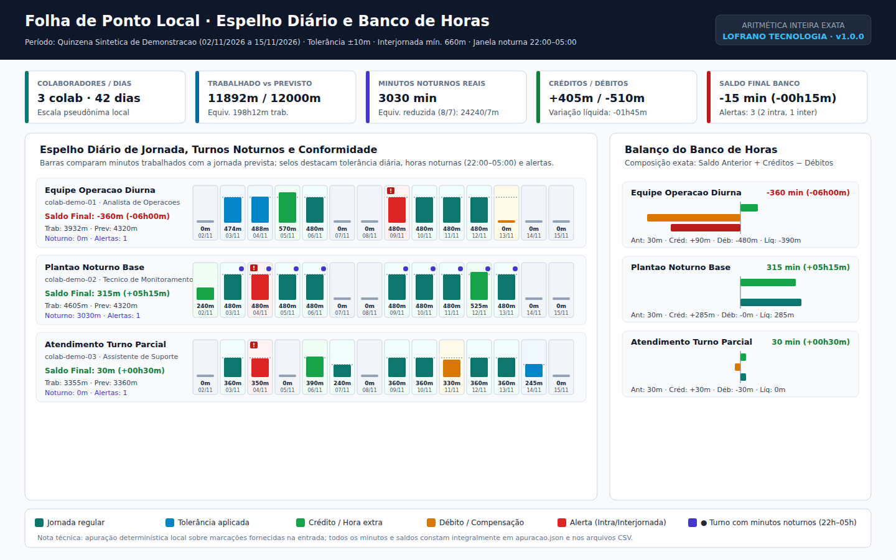

# Folha de Ponto Local

Apure espelho de ponto e banco de horas em minutos inteiros exatos a partir de registros locais em JSON. O **Folha de Ponto Local** avalia jornadas diurnas e turnos que cruzam a meia-noite, calcula a interseção exata com a janela noturna (`22:00` às `05:00`), aplica tolerância diária configurável, verifica intervalos intrajornada e descansos interjornada e consolida créditos, débitos e saldos acumulados sem ponto flutuante.

CLI e biblioteca Python da [LOFRANO TECNOLOGIA](https://lofranotecnologia.com.br/), em português, sob [licença MIT](LICENSE). O motor executa somente a biblioteca padrão do Python (3.11+): não usa servidor externo, rede, banco de dados remoto ou dependências de terceiros em tempo de execução.



## Experimentar

Requer Python 3.11 ou posterior. Crie um ambiente virtual e instale o pacote local:

```sh
git clone https://github.com/martinlofranodeoliveira/folha-ponto-local.git
cd folha-ponto-local
python -m venv .venv
```

No Linux/macOS:

```sh
.venv/bin/python -m pip install .
.venv/bin/folha-ponto-local exemplo --saida exemplo-folha-ponto.zip
```

No Windows:

```powershell
.venv\Scripts\python -m pip install .
.venv\Scripts\folha-ponto-local exemplo --saida exemplo-folha-ponto.zip
```

A [versão 1.0.0](https://github.com/martinlofranodeoliveira/folha-ponto-local/releases/tag/v1.0.0) oferece wheel, código-fonte (`sdist`), pacote ZIP do exemplo sintético, imagem de referência e manifesto `SHA256SUMS`.

Descompacte `exemplo-folha-ponto.zip` e abra `mapa-jornada.svg`, `RELATORIO.md` e `LEIA-ME.md`. O cenário sintético avalia três colaboradores pseudônimos ao longo de 14 dias (42 registros diários): dias regulares dentro da tolerância de ±10 minutos, créditos de hora extra, trabalho em feriado (+240 min), turnos noturnos cruzando `22:00–05:00` e meia-noite (3.030 minutos noturnos reais), dois alertas de intrajornada e um alerta de interjornada (570 min de descanso < 660 min).

## Apurar seus arquivos

```sh
folha-ponto-local apurar entrada.json --saida resultado.zip
```

O documento de entrada segue o esquema `schema_version: 1` detalhado em [FORMATO.md](docs/FORMATO.md) e na [API Python](docs/API.md). O pacote ZIP gerado contém oito arquivos em ordem lexicográfica fixa:

| Arquivo no ZIP | Conteúdo |
| --- | --- |
| `LEIA-ME.md` | Guia rápido de leitura dos arquivos e limites do pacote |
| `RELATORIO.md` | Relatório textual auditável em português com tabelas e aviso de escopo técnico |
| `SHA256SUMS` | Hashes SHA-256 dos outros sete arquivos do pacote |
| `apuracao.json` | Memória de cálculo estruturada por colaborador, dia e batida |
| `entrada.json` | Bytes originais exatos da entrada analisada |
| `espelho-diario.csv` | Tabela diária em UTF-8 (LF) com proteção contra injeção de fórmulas |
| `mapa-jornada.svg` | Painel visual estático (1440×900) do espelho diário e balanço do banco de horas |
| `resumo-colaboradores.csv` | Totais consolidados de minutos, créditos, débitos, saldos e alertas |

Um caminho de saída já existente (arquivo ou symlink) nunca é sobrescrito: a publicação prepara um temporário no mesmo diretório e faz vínculo atômico exclusivo via `os.link`.

## Regras de cálculo e alertas

1. **Aritmética exata em minutos (`int`)**: cada carimbo `YYYY-MM-DDTHH:MM` é convertido em minuto inteiro absoluto. Não há uso de `float` em nenhuma etapa do motor ou dos relatórios. A equivalência de hora noturna reduzida (fator `8/7`, razão `60 / 52,5`) é calculada com `fractions.Fraction`.
2. **Tolerância diária**: quando `minutos_previstos > 0` e `0 < abs(minutos_trabalhados - minutos_previstos) <= tolerancia_diaria_minutos`, a variação líquida do dia é `0` (`tolerancia_aplicada: true`). Fora da tolerância, a variação integral (`minutos_trabalhados - minutos_previstos`) é lançada como crédito ou débito no banco de horas.
3. **Alertas de conformidade**:
   - `INTRAJORNADA_INSUFICIENTE`: jornada trabalhada acima de `360` minutos com intervalo intrajornada inferior a `intrajornada_minima_acima_6h_minutos` (ex.: `60` min), ou jornada entre `241` e `360` minutos com intervalo inferior a `intrajornada_minima_4h_a_6h_minutos` (ex.: `15` min).
   - `INTERJORNADA_INSUFICIENTE`: descanso entre a última saída do dia trabalhado anterior e a primeira entrada do dia atual inferior a `interjornada_minima_minutos` (ex.: `660` min = 11h).

> **Aviso de escopo técnico:** esta ferramenta realiza apuração aritmética determinística sobre marcações e parâmetros declarados pelo usuário. Não constitui homologação jurídica, trabalhista ou contábil, nem substitui registrador eletrônico de ponto (REP).

## Desenvolver e conferir

```sh
python -m pip install . -r requirements-build.txt
python -m unittest discover -s tests -v
python -m build
python scripts/check_distribution.py --dist dist
python tools/verify_independent.py --cli "$(command -v folha-ponto-local)"
```

O verificador independente em [INTEROPERABILIDADE.md](docs/INTEROPERABILIDADE.md) revalida pacotes ZIP sem importar `folha_ponto_local`, utilizando um oráculo discreto minuto a minuto (conjuntos de minutos inteiros) e agregação SQL via `sqlite3`. Os procedimentos de empacotamento e conferência de release estão em [VERIFICACAO.md](docs/VERIFICACAO.md).
